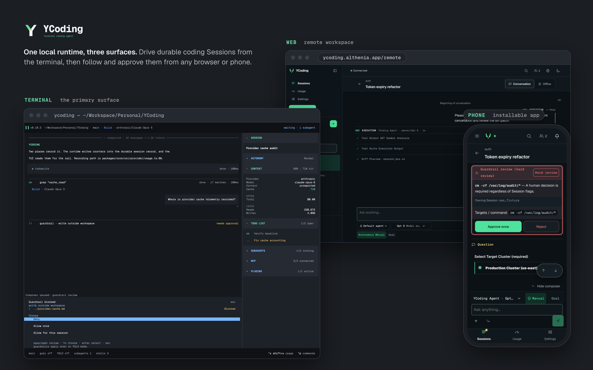
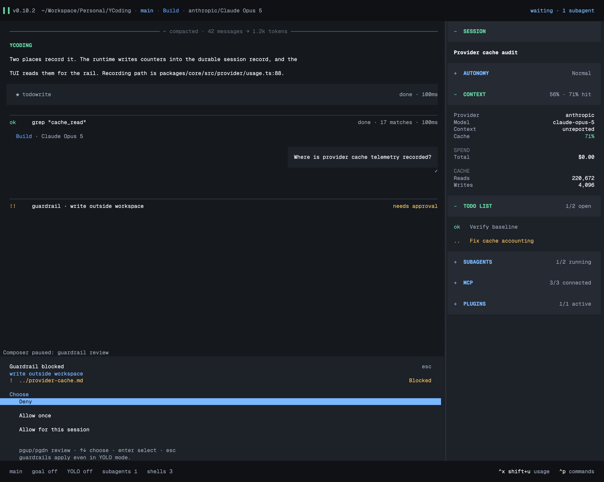
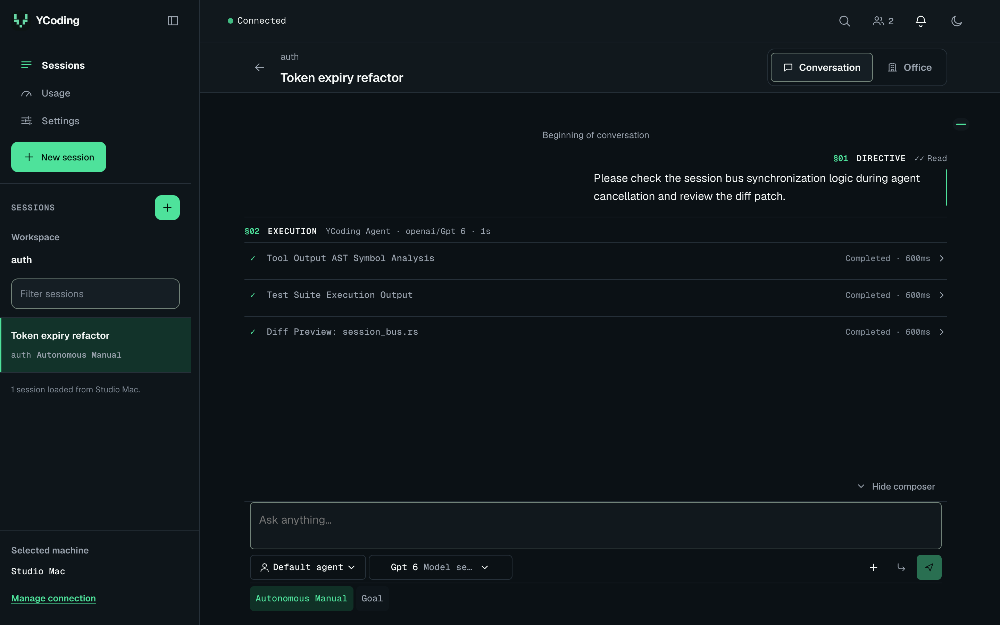
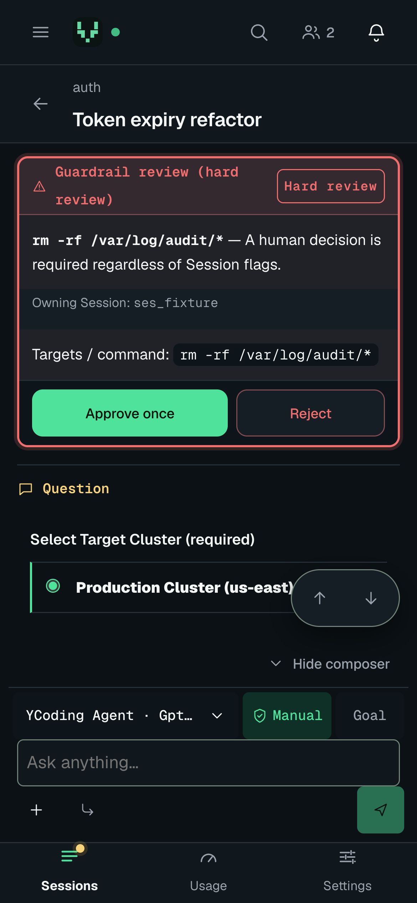

# YCoding

[](https://github.com/Althenia/ycoding/releases)
[](./LICENSE)
[](https://github.com/Althenia/ycoding/releases)
[](https://ycoding.althenia.app/docs)

**A terminal-first coding agent that runs on your own machine.** YCoding keeps every Session durable, lets you decide how much it may do on its own, and puts the same local runtime in your browser and on your phone when you step away from the terminal.

Your repository, shell, tools, and model calls stay in the local `ycoding` process. The web app is a remote control for that process, not a hosted agent.

Latency and client-timing telemetry stays in local SQLite and is disabled until you enable the machine-wide consent choice; token and cost usage remain available independently.

<p align="center">
  
</p>

## Why YCoding

- **Durable Sessions.** History, pending prompts, todos, and subagents survive restarts and reconnects. Steer a running Session or queue work for when it goes idle.
- **Autonomy you choose.** `/autonomous` sets Permissions, Guardrails and Answers independently to Manual, Auto or YOLO. Manual waits for decisions; Auto applies deterministic rules; YOLO removes every blocker in its category after explicit risk acceptance. YOLO can allow destructive actions and synthesize all question answers. You assume full responsibility. Project coordinators still delegate mutations to members.
- **Guardrails across the whole Session family.** Manual and Auto preserve hard reviews, explicit denies and ceilings. Guardrails YOLO permits all actions, including catastrophic and destructive rules, without review. Permissions and Answers retain their separate modes. Pending requests settle when their effective category becomes YOLO.
- **Defer decisions without stopping work.** `/defer` toggles the persistent root-family `defer: {}` presence marker without changing category modes or the goal. User prompts, steers, slash commands, shell input and skill input do not disable defer. Only an explicit toggle or `{ defer: false }` disables it. Enabling defer holds machine keep-awake and moves unresolved manual requests into the review box; disabling it releases the family hold. Startup restores persisted holds before serving Sessions without resuming provider work. Trusted System observations describe defer state, keep-awake status, battery drain and closed-lid heat. `/keep-awake` controls the separate manual machine preference. Run `ycoding keep-awake setup` for closed-lid system-sleep control on macOS; watch battery drain and heat.
- **Background subagents.** Delegate work to durable child Sessions that inherit your permission limits, and watch their progress in the Session rail.
- **Projects.** Manage coordination groups and their Sessions in dedicated TUI and web screens, with explicit roles, per-dispatch agent and reasoning choices recorded in receipts, one-writer leases, bounded event waits, delegated routine decisions, and notification filters. CLI and browser relay expose the same controls; stopping a group leaves workers intact, and restart requires human re-arm. See [the coordination contract](./specs/coordination.md).
- **Use your accounts side by side.** Keep several named profiles per provider — API keys or subscription sign-ins such as Claude Code, ChatGPT, or GitHub Copilot — and pick one per Session or subagent with `profile#provider/model#variant`. See [provider profiles](./docs/configuration.md#provider-profiles).
- **Many providers.** OpenAI, Anthropic, Google, GitHub Copilot, OpenRouter, xAI, Amazon Bedrock, Azure, Mistral, Groq, and more, plus any OpenAI-compatible endpoint.
- **Your phone as a remote.** The Focus workspace puts Sessions, Usage, and Settings in a collapsible desktop rail or a three-item phone bar, with explicit New session and Back actions. Enroll your machine once, then read transcripts, send prompts, and answer permissions, guardrail reviews, and questions from any browser or the installable phone app, with opt-in push alerts when a Session needs you.
- **Repository-native customization.** Agents, commands, skills, hooks, plugins, and MCP servers live next to your code.
- **YCoding Interaction.** On macOS, approve one Chrome tab or window at a time for the `interaction` tool. [Connect the bundled extension](./docs/browser-extension.md#connect-chrome) from its popup and allow the Chrome profile once on your Mac after the match codes agree; enrollment does not grant tab access.
- **Workspace memory.** Save and search [linked Markdown knowledge](./docs/memory.md) with an offline graph, kept separate from transcripts and prompts.
- **Next-message prediction.** Run `/suggest [hint]` in the TUI or web composer to get a suggested next message from recent conversation text, optionally with project or global memory: fill, never send.
- **Prompt drafts.** Run `/prompt <intent>` in the TUI or web composer to turn a rough intent into one draft prompt for review. Choose a mode and, optionally, project or global memory: fill, never send.
- **Opt-in meeting intelligence.** Run `ycoding meeting` for consented browser-tab capture from the [local live page](./docs/meeting-intelligence.md): configurable Thai Whisper transcription, evidence-backed plans and reviewed MCP proposals.

## Quick start

**Apple Silicon** — requires `curl`, `tar`, and `shasum` or `sha256sum`:

```sh
curl -fsSL https://ycoding.althenia.app/install.sh | sh
```

On a new installation, the installer downloads the highest stable Rust release, verifies its SHA-256 checksum, and installs `ycoding` in `~/.local/bin`. Follow the PATH instructions it prints, then open a new terminal in your project:

```sh
ycoding
```

Type `/connect` in the composer to add a provider profile, then describe your task.

YCoding v0.13.0 and v0.13.2 or later require Apple Silicon in the maintained installer. For Intel macOS or Linux x64, set `YCODING_VERSION` to a historical release that includes your platform's archive, such as v0.13.1. Historical Windows downloads are available on GitHub Releases.

Run a single prompt without opening the interface:

```sh
ycoding --model <[profile#]provider/model[#variant]> "Explain this repository"
```

Run `ycoding update` to stay on your existing edition: Bun updates to Bun 0.12.2, and Rust checks for stable Rust releases. The shell installer leaves Bun in place unless you pass `--replace-bun`. A clean Rust installation uses a separate store and does not import Bun data. See [installation](https://ycoding.althenia.app/docs/installation) for version selection, signature checks, and switching editions.

## Three surfaces, one runtime

| Terminal                                                                                                                                                                                                           | Web                                                                                                                                                                     | Phone                                                                                                                                            |
| ------------------------------------------------------------------------------------------------------------------------------------------------------------------------------------------------------------------ | ----------------------------------------------------------------------------------------------------------------------------------------------------------------------- | ------------------------------------------------------------------------------------------------------------------------------------------------ |
|  |  |  |
| The primary surface: transcript, Session rail, reviews, shells, and subagents in your terminal.                                                                                                                    | Sessions, conversations, usage, and settings for every Session on your enrolled machine.                                                                                | The same workspace on a phone, with opt-in push alerts for reviews, finished work, and offline machines.                                         |

To use the [remote workspace](https://ycoding.althenia.app/remote/), sign in, open **Settings → Devices → Create enrollment code**, and run the displayed command on your machine. It prompts for the one-use code, so the code never lands in shell history. Then turn on the connection:

```sh
ycoding remote enroll <enrollmentID>
ycoding remote connect
```

> [!WARNING]
> While the machine is connected, the signed-in account can reach every existing and future Session on that machine. Connect only machines and accounts you trust.

See [remote workspace](https://ycoding.althenia.app/docs/usage/remote) for sign-in options, recovery, and connection states.

### macOS desktop app

Download the separate signed Apple silicon Desktop ZIP from [GitHub Releases](https://github.com/Althenia/ycoding/releases), or build it from source with `bun run build:desktop -- --outdir=<fresh-directory>`. At startup, choose **Start my own backend** (a private bundled backend that stops when the window closes) or **Connect to a shared backend** (an explicit local URL or the running managed service, left running on close). It uses the same native client and events as the terminal, not the relay. See [packages/desktop](./packages/desktop/README.md).

### Native Dots access

Configure `"dots": { "enabled": true, "profile": "<OpenAI OAuth profile>" }` in trusted global configuration. The native connection is pinned to that profile's credential, account, and account generation. Open **Dots connection** from the TUI or web command palette, including without a selected Session. Its single Connect/Disconnect control changes a separate backend-wide preference that defaults Off. On grants native access to every existing and future eligible Session on that backend. Session creation does not enable it. Attaching this computer leaves other computers attached; choose which computer runs a Dots task in ChatGPT.

The connection view shows the selected profile, machine name when available, configuration readiness, global access, and actual transport state separately. Connected confirms the transport, not that an external client opened a conversation. Off revokes native authority without stopping admitted work or answering pending decisions. Native tasks and exact typed decisions use a private server-process Channel, not HTTP or the browser relay. Permissions, hard/custom guardrails, Forms, Questions, child questions, deferred reviews, and recovery retain their native validation, explicit denies, ceilings, and one-shot settlement. Prompt text grants no approval authority. Historical transcripts retain their source attribution. See [native Dots](specs/dots-native-connector.md).

An authenticated native executor channel runs commands and opens files with the host user's access. Session decision rules apply to typed decisions, not to these executor requests.

## Guardrails

Permissions decide what an agent may attempt; guardrails review or deny high-impact operations across the main Session and its subagents. An approval never overrides an explicit permission denial or a built-in catastrophic denial.

Add your own rules as one Markdown file per rule:

- **Workspace:** `.ycoding/guardrails/*.md` in the project.
- **User:** `~/.config/ycoding/guardrails/*.md`.

See the [guardrail guide](./docs/guardrails-and-provider-usage.md#session-guardrails) and the tested [AWS resource protection example](./docs/guardrails-and-provider-usage.md#aws-example-deny-destructive-resource-operations). Guardrails inspect supported tool actions and resource strings; they do not replace filesystem isolation or cloud IAM policies.

## Documentation

- [Getting started](https://ycoding.althenia.app/docs/getting-started) and [quickstart](https://ycoding.althenia.app/docs/quickstart)
- [Working in the terminal](https://ycoding.althenia.app/docs/usage/tui) and [command line](https://ycoding.althenia.app/docs/usage/cli)
- [Providers and profiles](https://ycoding.althenia.app/docs/configuration/providers), [agents](https://ycoding.althenia.app/docs/configuration/agents), [MCP](https://ycoding.althenia.app/docs/configuration/mcp), [goal](https://ycoding.althenia.app/docs/configuration/goal), and [autonomous mode](https://ycoding.althenia.app/docs/configuration/autonomous)
- [Troubleshooting](https://ycoding.althenia.app/docs/troubleshooting) and the [changelog](https://ycoding.althenia.app/changelog)
- Engineering references: [runtime](./docs/runtime.md), [configuration](./docs/configuration.md), [architecture](./docs/architecture.md), and the [documentation index](./docs/README.md)

<details>
<summary>Build from source</summary>

With **a current Bun release** installed:

```sh
bun install --frozen-lockfile
bun run dev
```

Build and smoke-test the terminal application, then install it locally on macOS or Linux:

```sh
bun run build:tui
bun run smoke:tui
bun run smoke:runtime
bun run install:local
```

Build and test the web app:

```sh
bun run build:web
bun run test:web
bun run test:remote
```

See [contributing guidance](./AGENTS.md) for targeted tests, repository checks, and the release process.

</details>

## License

YCoding is licensed under the GNU Affero General Public License, version 3 only (AGPL-3.0-only). See [LICENSE](./LICENSE) for the full text and [NOTICE](./NOTICE) for the upstream MIT notice it retains.

### Remote task MCP

`ycoding mcp serve` exposes an opt-in, single-owner OAuth-protected task interface through a separate localhost listener. Start, inspect, list, and cancel durable coding Sessions in isolated Git worktrees. See [Task MCP setup](docs/task-mcp.md) for external OAuth and Cloudflare Tunnel requirements.
